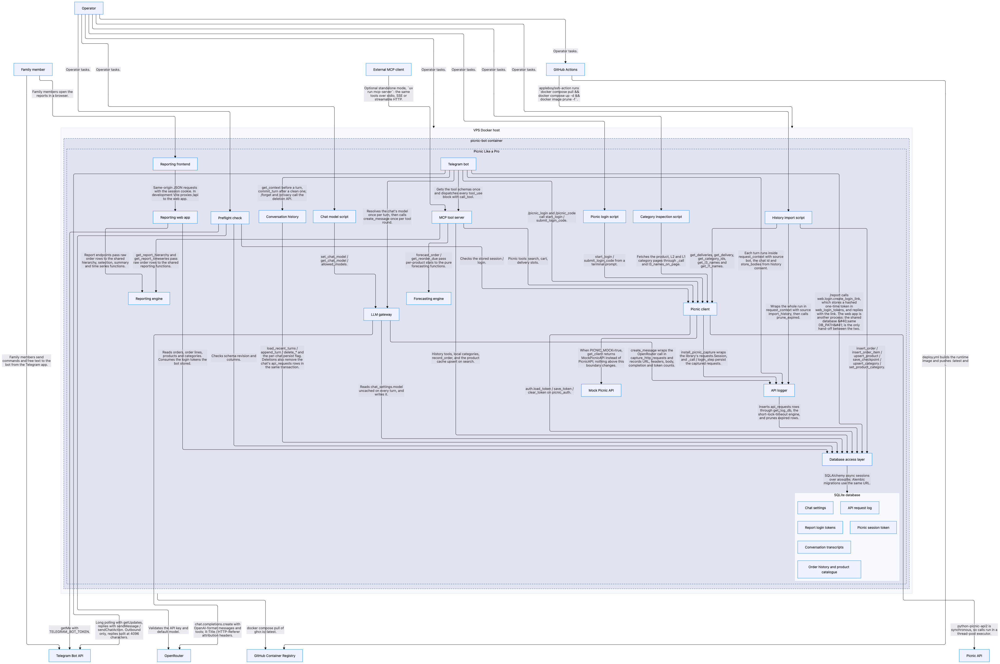

# Picnic Like a Pro — Architecture

Picnic Like a Pro is a family grocery and meal-planning assistant. A Telegram bot uses an
OpenRouter-hosted LLM and in-process MCP tools to access a shared Picnic account and a local
SQLite order history. The same MCP server can run standalone over stdio, SSE or streamable HTTP.
A separate, localhost-only FastAPI app serves the reporting UI.



## Architecture sources

This file is only the high-level orientation. Keep detailed inventories in one place:

- **[CALM architecture guide](calm/README.md)** — nodes, relationships, flows, controls, diagrams
  and validation commands.
- **[Machine-readable CALM model](calm/picnic-like-a-pro.architecture.json)** — the canonical
  component and dependency inventory.
- **[Implementation decisions](CLAUDE.md)** — database/session contracts, conversation history,
  Picnic integration, reporting rules, environment variables and development commands.
- **[Setup and operations](README.md)** — installation, configuration and deployment.
- **[Known limitations](OPEN_POINTS.md)** — privacy, retention and other open risks.

## Runtime boundaries

- `bot.py` owns Telegram handlers and the LLM tool loop; `llm.py` is the only module that knows the
  OpenAI-compatible wire format.
- `mcp_server.py` exposes Picnic, local-history, forecasting and reporting tools. The bot calls it
  in process; external MCP clients use a standalone server.
- `db/` is the only SQLAlchemy layer. Query helpers receive explicit async sessions and return plain
  dictionaries.
- `forecasting/engine.py` and `reporting.py` are pure Python, with no database or transport I/O.
- `web/app.py` is a separate read-only reporting process. It is not part of the bot container.

The CALM guide's [node table](calm/README.md#nodes),
[flow table](calm/README.md#flows) and [control table](calm/README.md#controls) contain the complete
inventory; do not duplicate tool lists, schemas or migration histories here.

## Multi-user design notes

All family members share one Picnic account, cart and order history. Telegram conversation history
is isolated by `chat_id`, persisted in SQLite when consent allows it, and never shared across chats.
`ALLOWED_TELEGRAM_USER_IDS` restricts access to the bot and reporting UI; `ALLOW_ALL_USERS=true` is
for local development only. See CALM control **PLP-AC-01** and the access/history sections in
`CLAUDE.md`.

### MCP transports

| Mode | Use case |
|---|---|
| In process | Normal Telegram-bot operation |
| stdio | Local clients such as Claude Desktop |
| SSE / streamable HTTP | Remote or multi-client access |

`MCP_TRANSPORT` selects the standalone transport; host and port default to localhost and 8000.

## Reporting boundary

Both `mcp_server.py` and `web/app.py` load raw orders, order lines and products through
`db.queries.report_*`, then call the shared `reporting.py` composition functions. Hierarchy and
time-series policy therefore lives once, in the CALM `reporting-engine` node. Transport adapters
retain their own validation and error shapes: FastAPI uses HTTP errors, while MCP tools return error
dictionaries.

The web UI requires a signed session cookie and rechecks the Telegram allowlist on every request.
The standalone MCP server is a separate trust boundary; it does not reuse web sessions.

## Persistence and privacy

The single SQLite file holds order history, conversation transcripts, settings, credentials and API
logs. It is unencrypted, retention is not universally bounded, and deleting rows does not scrub the
underlying pages until SQLite vacuums them. Protect the database and its backups accordingly. See
`OPEN_POINTS.md` and CALM controls **PLP-DP-01** through **PLP-DP-07** for the current guarantees.

The order-history import is re-runnable and derives its work list from deliveries not yet present in
`orders`. Category backfill, checkpoints, retries and API-log retention are documented in `CLAUDE.md`;
the end-to-end route is the CALM `history-import` flow.

## Environments

| Environment | Picnic API | Data | Entry point |
|---|---|---|---|
| Production | Real | Persistent Docker volume | `docker-compose.yml` |
| Mock | In-process fake | Separate persistent volume | `docker-compose.mock.yml` |
| Test | In-process fake | Ephemeral test database/volume | pytest or `docker-compose.test.yml` |

Use the `Makefile` targets for the supported commands and environment lifecycle.

## Deployment

Production runs as one container on a Docker host. The manual GitHub Actions deployment builds and
pushes the image to GHCR, then recreates the container over SSH. The SQLite volume persists across
restarts, and Alembic migrations run before application startup. The bot uses outbound connections
only; the reporting web app remains a separate localhost process. See CALM **PLP-NE-01**,
**PLP-NE-02**, the `build-and-deploy` flow, and `README.md` for operations.

## Changing the architecture

When adding or rewiring a module, service, data store or guarantee:

1. Update the CALM nodes, relationships, flows and controls in the same change.
2. Update `CLAUDE.md` when implementation invariants or contributor commands change.
3. Regenerate affected CALM diagrams and validate from `calm/`:

   ```bash
   calm validate -a picnic-like-a-pro.architecture.json -u url-mapping.json --strict -f pretty
   ```

4. Run the test suite with `make test-fast`, or `make test` when checking coverage.
