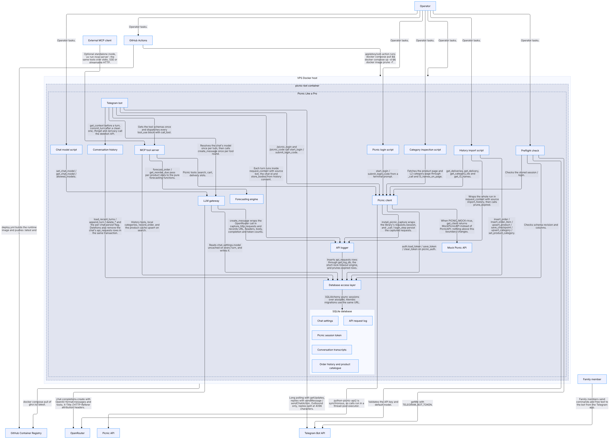
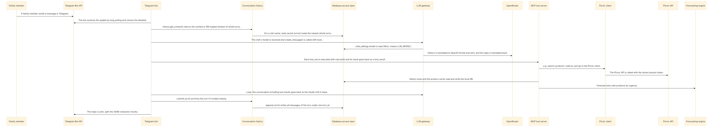

# CALM architecture model

[FINOS CALM](https://calm.finos.org) (Common Architecture Language Model) description of
Picnic Like a Pro: a machine-readable JSON model of the system's nodes, relationships, business
flows and controls, validated against the CALM 1.2 schema.

| File | What it is |
|---|---|
| `picnic-like-a-pro.architecture.json` | The architecture: 34 nodes, 43 relationships, 5 flows, 19 controls |
| `controls/*.requirement.json` | JSON Schemas for the 5 control kinds; every control's `config` is validated against one |
| `url-mapping.json` | Maps the controls' published `requirement-url`s to the local files, so validation works offline and before merge |
| `diagrams/` | PNGs rendered by `calm docify` (overview + one per flow) |



## Commands

```bash
npm install -g @finos/calm-cli          # tested with 1.68.0
cd calm

# Validate (schema + every control config against its requirement schema)
calm validate -a picnic-like-a-pro.architecture.json -u url-mapping.json --strict -f pretty

# Browsable docs site with diagrams for every node, relationship and flow.
# docify writes a Docusaurus project, not HTML: install and serve it to browse.
calm docify -a picnic-like-a-pro.architecture.json -u url-mapping.json -o /tmp/calm-docs
cd /tmp/calm-docs
# Workaround, needed after every docify: d3 7.9.2 is marked side-effect free, so webpack drops
# d3-transition and hovering a diagram node throws "tooltipElem.transition is not a function".
mkdir -p src && echo "import 'd3-transition';" > src/d3-transition.js
perl -pi -e "s|^(\s*themes: \[)|    clientModules: [require.resolve('./src/d3-transition.js')],\n\$1|" docusaurus.config.js
npm install && npm start    # http://localhost:3000

# PNGs for diagrams/ (not for the site: its pages then point at image files Docusaurus does not serve).
# Needs a Chromium; add --browser-path if it isn't found.
calm docify -a picnic-like-a-pro.architecture.json -u url-mapping.json -o /tmp/calm-png \
  --export-diagrams png
cp /tmp/calm-png/docs/_diagrams/index-1.png diagrams/overview.png
for f in /tmp/calm-png/docs/flows/_diagrams/*-1.png; do
  cp "$f" "diagrams/flow-$(basename "$f" -1.png).png"
done
```

Keep relationship and flow-transition descriptions free of `(` `)` and `;`: docify shows parentheses in edge labels as
HTML entities, and Mermaid reads `;` in a sequence-diagram message as a line break.  Keep `{` and `}`
out of every string: the generated pages are MDX, which reads braces as a JavaScript expression and
fails to compile the page.

When the code changes, update the JSON in the same PR. Each node's `metadata.code` lists the files
it stands for, so `git diff --stat` shows which nodes to check.

---

## How the model maps to the code

### Nodes

CALM nodes don't have to be deployable units. Here, each **service** node is a Python module or
package with one job and a narrow interface. In production almost all of them run in **one
process** (`uv run bot`), so most relationships between them are function calls, not network
hops (`metadata.transport: "in-process call"`).

| Node (`unique-id`) | CALM type | Code | What decides the boundary |
|---|---|---|---|
| `family-member` | actor | — | Telegram users in `ALLOWED_TELEGRAM_USER_IDS` |
| `operator` | actor | — | Whoever owns `.env`, the VPS and the scripts |
| `telegram-bot-api` | system | external | Reached by long polling in `bot.py::main` |
| `openrouter` | system | external | `llm.py::get_client` (`AsyncOpenAI`, `OPENROUTER_BASE_URL`) |
| `picnic-api` | system | external | reached only through `python-picnic-api2` |
| `external-mcp-client` | system | external | Claude Desktop etc., via `uv run mcp-server` |
| `github-actions` | system | `.github/workflows/test.yml`, `deploy.yml` | CI + manual deploy |
| `ghcr` | system | external | image registry used by `deploy.yml` and `docker-compose.yml` |
| `vps-host` | system | `docker-compose.yml` | the Docker host |
| `picnic-bot-container` | container | `Dockerfile` (stage `runtime`), `docker-compose.yml` | the one container; volume `picnic-data` → `/app/data` |
| `picnic-like-a-pro` | system | `src/picnic_meal_planner/`, `scripts/` | the whole repository, via `composed-of` |
| `telegram-bot` | service | `bot.py` | handlers, allowlist, the tool-use loop `_run_llm`, startup schema gate |
| `llm-gateway` | service | `llm.py` | the only module that knows the OpenAI wire format, plus per-chat model choice |
| `api-log` | service | `api_log.py` | best-effort, replayable log of every Picnic/OpenRouter HTTP call; credentials masked |
| `conversation-history` | service | `history.py` | all history policy; `bot.py` calls only `get_context` / `commit_turn` |
| `mcp-tool-server` | service | `mcp_server.py` | the 15 tools; in-process via `call_tool`, or standalone over stdio/SSE/HTTP |
| `picnic-client` | service | `picnic/client.py`, `picnic/auth.py` | the only code that talks to Picnic; token-first login, 2FA `LoginFlow`, category lookups |
| `mock-picnic-api` | service | `picnic/mock_client.py` | swapped in by `PICNIC_MOCK=true` |
| `forecasting-engine` | service | `forecasting/engine.py` | pure functions, no I/O |
| `db-access-layer` | service | `db/engine.py`, `db/models.py`, `db/queries.py`, `alembic/` | the only code that touches SQLAlchemy; two engines on one file (`get_db`, and `get_log_db` with a 0.2 s lock timeout) |
| `sqlite-db` | database | the file at `DB_PATH` | shared by every process in the container |
| `order-history` | data-asset | tables `products`, `categories`, `category_parents`, `orders`, `order_items`, `import_checkpoints` | |
| `conversation-transcripts` | data-asset | table `conversation_messages` | personal data |
| `api-request-log` | data-asset | table `api_requests` | personal data (prompts, tool results, orders in bodies) |
| `chat-settings` | data-asset | table `chat_settings` | |
| `picnic-session-token` | data-asset | table `picnic_auth` | a credential |
| `import-history-job` | service | `scripts/import_history.py` | |
| `picnic-login-cli` | service | `scripts/picnic_login.py` | the shell front end to the same `LoginFlow` |
| `chat-model-cli` | service | `scripts/chat_model.py` | |
| `preflight-cli` | service | `scripts/preflight.py` | |
| `inspect-category-cli` | service | `scripts/inspect_category.py` | diagnostic dump of a product's category pages |
| `reporting-web` | service | `web/app.py`, `web/login.py`, `web/reports.py`, `access.py` | the FastAPI process (`uv run web`): read-only reports, login links, session cookie; not in the container |
| `reporting-frontend` | webclient | `frontend/` | the React app in the browser; only talks to `reporting-web` |
| `web-login-tokens` | data-asset | table `web_login_tokens` | a credential while unused; only hashes are stored |

`node-type: "container"` is a custom type, which CALM allows. The data assets sit inside `sqlite-db`
through a `composed-of` relationship (`database-contents`), so the diagram draws the database as a
box holding its six kinds of data.

### Interfaces

Interfaces name **what a caller uses**, and `connects` relationships refer to them:

- External endpoints carry a URL: `bot-api-https`, `chat-completions`, `picnic-storefront`, `oci-registry`.
- In-process interfaces list the functions that form the module's surface, e.g.
  `history-api` → `get_context, commit_turn, …`, `mcp-in-process` → `get_tool_schemas, call_tool`.
- `mcp-tool-server` has three interfaces (in-process, stdio, sse/http). They match the three transports
  in `ARCHITECTURE.md`.

### Relationships

| CALM relationship type | Used for | Example |
|---|---|---|
| `interacts` | actor ↔ system | `family-member-uses-telegram`, `operator-runs-tooling` |
| `connects` | a call from one node to another | `bot-calls-tools` = `bot.py::_call_mcp_tool` → `mcp_server.call_tool` |
| `composed-of` | logical containment | `system-composition`, `database-contents` |
| `deployed-in` | runtime placement | `container-deployment`, `host-deployment` |

`protocol` is only set for real network hops (`HTTPS`, and `TCP` for the SSH deploy, because CALM's
protocol list has no SSH). In-process edges have no protocol and have `metadata.transport` instead.

### Flows

| Flow | Code path |
|---|---|
| `chat-turn` | `bot._chat` → `_run_llm` (inside `api_log.request_context`) → `history.get_context` → `llm.create_message` ↔ `mcp_server.call_tool` (loop, every HTTP call logged) → `history.commit_turn` |
| `history-import` | `scripts/import_history.py`: `import_deliveries`, then `backfill_categories` (`get_category_ids`, `get_l3_names`, `upsert_category`), then `backfill_parent_names` (`get_l1_names`, `upsert_category_parent`), then `refresh_category_names` (`get_l3_names`, `upsert_category`), then `api_log.prune_expired` |
| `picnic-2fa-login` | `bot.cmd_picnic_login` → `client.start_login` → `auth.LoginFlow.start`; `cmd_picnic_code` → `submit_login_code` → `_install` → `auth.save_token` |
| `report-login` | `bot.cmd_report` → `web.login.create_login_link` → `web_login_tokens` (the bot and the web app meet only in the database); browser → `POST /api/auth/login` → `redeem_login_token` → cookie; then `/api/hierarchy` and `/api/timeseries` → `queries.report_*` → `web/reports.py` |
| `build-and-deploy` | `deploy.yml`: `build-and-push` job, then the `deploy` job over SSH |

Each transition refers to a relationship by id, so a flow is a route through the graph above.



### Controls

The controls are the guarantees that `CLAUDE.md` describes in prose. Each one's `config` points at
the code that enforces it (`enforced-in`) and the document that explains it (`documented-in`), and
must satisfy the schema for its kind in `controls/`:

| Kind | Controls |
|---|---|
| `access-control` | PLP-AC-01 user allowlist · PLP-AC-02 Picnic login authorisation · PLP-AC-03 model allowlist · PLP-AC-04 report session and allowlist |
| `data-protection` | PLP-DP-01 storage consent · PLP-DP-02 retention/erasure · PLP-DP-03 session token handling · PLP-DP-04 API log follows history consent · PLP-DP-05 credential redaction in the API log · PLP-DP-06 one-time login links · PLP-DP-07 reports read order data only |
| `integrity` | PLP-IN-01 clean-turn archiving · PLP-IN-02 turn-aware window · PLP-IN-03 schema gate · PLP-IN-04 no unprompted 2FA · PLP-IN-05 API logging never affects the request |
| `network-exposure` | PLP-NE-01 no inbound ports · PLP-NE-02 reports listen on localhost |
| `human-in-the-loop` | PLP-HL-01 confirm cart changes |

The `requirement-url`s point at `raw.githubusercontent.com/.../main/calm/controls/`, so they resolve
once this is merged. Until then, and offline, `-u url-mapping.json` serves them from the local files.
